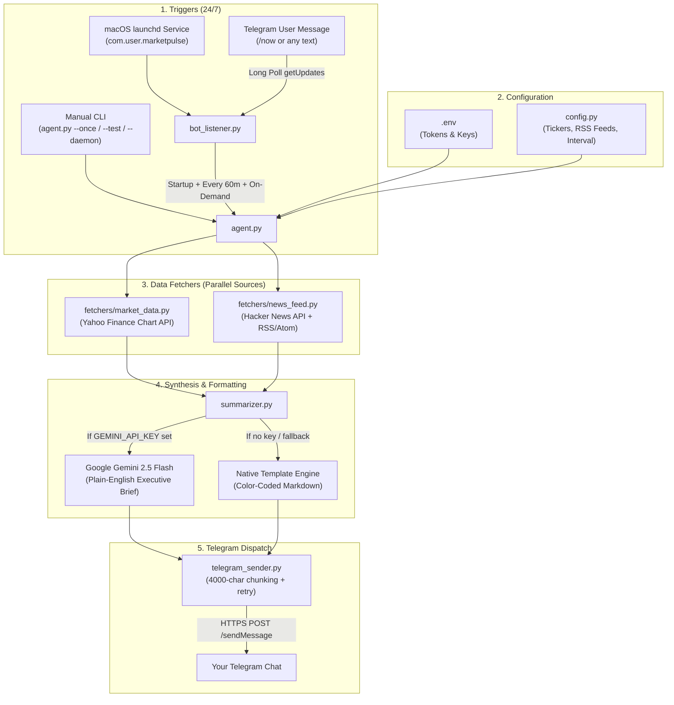

# 🌐 Helix-Agents-App — MarketPulse Personal Intelligence Agent

**MarketPulse** is an autonomous, zero-dependency Python intelligence agent built into **Helix-Agents-App**. It continuously tracks global financial markets, tech & AI tool releases, and world macroeconomic news—synthesizing everything into a crisp, mobile-friendly briefing delivered directly to your **Telegram** automatically every hour and **instantly on demand** whenever you message the bot.

---

## 📋 Table of Contents

1. [Key Features](#-key-features)
2. [System Architecture](#-system-architecture)
3. [How Data & News Flow (Step-by-Step)](#-how-data--news-flow-step-by-step)
4. [Complete File-by-File Reference](#-complete-file-by-file-reference)
5. [Comparison: MarketPulse vs. Other Solutions](#-comparison-marketpulse-vs-other-solutions)
6. [Data Sources & APIs](#-data-sources--apis)
7. [A-to-Z Setup Guide](#-a-to-z-setup-guide)
8. [Running & Automating (CLI + macOS Background Service)](#-running--automating-cli--macos-background-service)
9. [Customization Guide](#-customization-guide)
10. [Troubleshooting & Security](#-troubleshooting--security)

---

## ⚡ Key Features

* **Zero External Python Dependencies**: Built 100% with Python 3 standard library (`urllib.request`, `json`, `xml.etree.ElementTree`, `argparse`, `datetime`). No `pip install` or virtual environment required.
* **Hands-Free Auto-News**: Automatically fetches and pushes fresh briefings on a configurable schedule (default: **every 60 minutes**).
* **Instant On-Demand Updates (`/now`)**: Runs a 24/7 Telegram long-polling listener—send `/now` or any message in Telegram and get a live briefing in seconds.
* **Dual-Engine Summarization**:
  * **AI Mode**: Uses **Google Gemini (`gemini-2.5-flash`)** when `GEMINI_API_KEY` is provided to explain market moves and tool launches in plain English.
  * **Native Fallback Mode**: Uses a deterministic Markdown formatter with color-coded indicators (`🟢` / `🔴` / `⚪`) if no API key is configured or if the API is unreachable.
* **Resilient Telegram Delivery**: Automatically chunks messages over 4,000 characters and falls back to plain text if external headlines contain unescaped Markdown characters.
* **macOS Background Daemon**: Includes a `launchd` installer (`install_launchd.sh`) with `KeepAlive` so the agent survives reboots and runs silently in the background.

---

## 🏗️ System Architecture



---

## 🔄 How Data & News Flow (Step-by-Step)

1. **Trigger (`bot_listener.py` / `agent.py`)**:
   * On startup, `bot_listener.py` immediately runs `run_pipeline()` so you get a briefing right away.
   * It continuously long-polls Telegram (`getUpdates`, 20-second timeout). Any message from your `TELEGRAM_CHAT_ID` triggers an immediate `run_pipeline()`.
   * An internal timer tracks `SCHEDULE_INTERVAL_MINUTES` (default `60`) and automatically runs `run_pipeline()` when the interval elapses.
2. **Market Data Fetching (`fetchers/market_data.py`)**:
   * Iterates over `MARKET_SYMBOLS` in `config.py`.
   * Requests 5-day daily chart JSON from Yahoo Finance (`https://query1.finance.yahoo.com/v8/finance/chart/<ticker>?interval=1d&range=5d`).
   * Computes current price, absolute change, and percentage change (`change_pct`).
3. **News & Tools Fetching (`fetchers/news_feed.py`)**:
   * **Tech & Tools**: Fetches top story IDs from Hacker News (`topstories.json`) and resolves each item's title, score, and URL. Parses RSS/Atom XML feeds from TechCrunch, The Verge, and Ars Technica.
   * **World & Macro**: Parses RSS XML feeds from Google News Business, Google News Markets, and MarketWatch.
4. **Briefing Synthesis (`summarizer.py`)**:
   * Combines `market_data` and `news_data`.
   * If `GEMINI_API_KEY` is present, sends the structured JSON to `gemini-2.5-flash` to produce a 350–450 word plain-English briefing (`MARKETS AT A GLANCE`, `NEW TECH & TOOLS`, `WORLD & MACRO HIGHLIGHTS`, `THE BOTTOM LINE`).
   * Otherwise, `format_native_briefing()` formats all indices, tech giants, crypto, commodities, and top links cleanly.
5. **Delivery (`telegram_sender.py`)**:
   * Splits briefings exceeding 4,000 characters at newline boundaries to respect Telegram's 4,096-character message limit.
   * Sends via `https://api.telegram.org/bot<TOKEN>/sendMessage` with `parse_mode="Markdown"`. If Telegram rejects malformed Markdown entities from external headlines, it automatically retries in plain text.

---

## 📁 Complete File-by-File Reference

| File / Folder | Purpose |
| :--- | :--- |
| [`agent.py`](file:///Users/raunak/Downloads/project/agent.py) | Main CLI entrypoint and `run_pipeline()` orchestrator. Supports `--test` (dry run), `--test-telegram`, `--once`, and `--daemon`. Includes a built-in `.env` loader. |
| [`bot_listener.py`](file:///Users/raunak/Downloads/project/bot_listener.py) | 24/7 interactive + scheduled daemon. Sends an initial briefing on launch, listens for `/now` or any message via Telegram `getUpdates`, and auto-pushes every `SCHEDULE_INTERVAL_MINUTES`. |
| [`config.py`](file:///Users/raunak/Downloads/project/config.py) | Central configuration for `MARKET_SYMBOLS`, `RSS_FEEDS` (`tech` and `macro_world`), `HN_TOP_STORIES_COUNT`, and `SCHEDULE_INTERVAL_MINUTES`. |
| [`fetchers/market_data.py`](file:///Users/raunak/Downloads/project/fetchers/market_data.py) | Fetches live quotes and daily percentage changes from Yahoo Finance's chart API with per-ticker error isolation. |
| [`fetchers/news_feed.py`](file:///Users/raunak/Downloads/project/fetchers/news_feed.py) | Fetches Hacker News top stories (JSON) and parses RSS/Atom XML feeds (`xml.etree.ElementTree`) for tech and macro news. |
| [`summarizer.py`](file:///Users/raunak/Downloads/project/summarizer.py) | Generates the mobile-ready briefing via Google Gemini (`summarize_with_gemini`) or the zero-dependency native template (`format_native_briefing`). |
| [`telegram_sender.py`](file:///Users/raunak/Downloads/project/telegram_sender.py) | Dispatches formatted messages to Telegram with automatic chunking (`split_message`) and Markdown-to-plain-text fallback. |
| [`get_chat_id.py`](file:///Users/raunak/Downloads/project/get_chat_id.py) | Setup helper that queries Telegram `getUpdates` after you message your bot and writes `TELEGRAM_CHAT_ID` directly into `.env`. |
| [`install_launchd.sh`](file:///Users/raunak/Downloads/project/install_launchd.sh) | Installs `com.user.marketpulse` into `~/Library/LaunchAgents/` so macOS keeps `bot_listener.py` running in the background across reboots. |
| [`.env.example`](file:///Users/raunak/Downloads/project/.env.example) | Template for environment variables (`TELEGRAM_BOT_TOKEN`, `TELEGRAM_CHAT_ID`, `GEMINI_API_KEY`, `SCHEDULE_INTERVAL_HOURS`). |
| [`src/`](file:///Users/raunak/Downloads/project/src) & [`supabase/`](file:///Users/raunak/Downloads/project/supabase) | The Helix-Agents-App React + TypeScript + Supabase web application living alongside the Python agent in this repository. |

---

## ⚖️ Comparison: MarketPulse vs. Other Solutions

| Feature / Criteria | **MarketPulse (This Agent)** | **Manual Browsing / News Apps** | **Zapier / Make / n8n Bots** | **Heavy Agent Frameworks (LangChain / AutoGPT)** | **Paid Terminals / Pro Newsletters** |
| :--- | :--- | :--- | :--- | :--- | :--- |
| **Cost** | **Free** (optional free-tier Gemini key) | Free (ad-supported) | Paid monthly tiers for frequent polling | API costs + hosting costs | \$20–\$2,000+/month |
| **Dependencies** | **Zero** (Python 3 stdlib only) | Browser / multiple apps | Cloud SaaS account required | Heavy `pip` trees, vector DBs, Docker | Proprietary software |
| **Delivery Channel** | **Direct to Telegram** (auto + `/now`) | You must open & search apps | Webhook / Telegram (rate-limited) | Usually CLI or custom web UI | Email / desktop terminal |
| **Instant + Auto Schedule** | **Both** (60m auto + instant `/now`) | Manual only | Scheduled (instant triggers cost extra) | Requires custom server setup | Fixed newsletter times |
| **AI Plain-English Synthesis** | **Built-in** (Gemini + native fallback) | None (raw articles) | Requires paid AI connector step | LLM-dependent (breaks without key) | Human-written (not real-time) |
| **Privacy & Control** | **100% Local** on your Mac; tokens stay in `.env` | Tracked by ad networks | Data passes through 3rd-party cloud | Local or cloud | Vendor-controlled |
| **Resilience** | Graceful per-feed errors + plain-text fallback | N/A | Workflow fails on malformed XML | Brittle prompt/tool chains | High |

---

## 📡 Data Sources & APIs

* **Markets (Yahoo Finance Chart API)**:
  * **Indices**: S&P 500 (`^GSPC`), Nasdaq 100 (`^IXIC`), Dow Jones (`^DJI`), India Nifty 50 (`^NSEI`)
  * **Tech Leaders**: Nvidia (`NVDA`), Apple (`AAPL`), Microsoft (`MSFT`), Google (`GOOGL`), Tesla (`TSLA`)
  * **Crypto**: Bitcoin (`BTC-USD`), Ethereum (`ETH-USD`)
  * **Macro & Commodities**: Gold (`GC=F`), Crude Oil WTI (`CL=F`), US 10Y Yield (`^TNX`), US Dollar Index (`DX-Y.NYB`)
* **Tech & Tools**:
  * Hacker News Firebase API (`hacker-news.firebaseio.com/v0/topstories.json`)
  * TechCrunch RSS, The Verge Atom feed, Ars Technica RSS
* **World & Macro**:
  * Google News Business RSS, Google News Markets RSS, MarketWatch Top Stories RSS
* **AI & Messaging**:
  * Google Gemini API (`generativelanguage.googleapis.com/v1beta/models/gemini-2.5-flash:generateContent`)
  * Telegram Bot API (`api.telegram.org/bot<TOKEN>/getUpdates` & `/sendMessage`)

---

## 🚀 A-to-Z Setup Guide

### Step 1: Create Your Telegram Bot (60 seconds)
1. Open Telegram and message [**@BotFather**](https://t.me/BotFather).
2. Send `/newbot`, choose a display name (e.g., `MarketPulse`) and a username ending in `bot`.
3. Copy the **HTTP API Token**.

### Step 2: Configure `.env`
```bash
cp .env.example .env
```
Edit `.env` and add your bot token (and optionally a free Gemini key from [Google AI Studio](https://aistudio.google.com/)):
```ini
TELEGRAM_BOT_TOKEN=your_bot_token_here
TELEGRAM_CHAT_ID=
GEMINI_API_KEY=
SCHEDULE_INTERVAL_MINUTES=60
```

### Step 3: Link Your Telegram Chat ID
1. Open your new bot in Telegram and tap **Start** (or send `hi`).
2. Run the auto-detector (or get your ID from [**@userinfobot**](https://t.me/userinfobot) and paste it into `.env`):
   ```bash
   python3 get_chat_id.py
   ```

### Step 4: Verify Connection
```bash
python3 agent.py --test-telegram
```
You should immediately receive a confirmation ping in Telegram.

---

## 🕒 Running & Automating (CLI + macOS Background Service)

### Manual CLI Commands
```bash
# Dry run in terminal (no Telegram message sent)
python3 agent.py --test

# Fetch live data and send one briefing to Telegram right now
python3 agent.py --once

# Run the continuous interactive + auto-news listener in foreground
python3 -u bot_listener.py
```

### 24/7 macOS Background Service (`launchd`)
To run silently in the background (auto-starts on login and restarts if interrupted):
```bash
./install_launchd.sh
```
> [!NOTE]
> **macOS Privacy (TCC) Tip**: macOS restricts background `launchd` daemons from reading files inside `~/Downloads`, `~/Documents`, or `~/Desktop` (`Operation not permitted`). For `launchd` background execution, keep a runtime copy in your home folder (e.g. `/Users/<you>/market_agent/`) as configured in [`install_launchd.sh`](file:///Users/raunak/Downloads/project/install_launchd.sh).

**Manage the background service:**
```bash
# Check status
launchctl list | grep marketpulse

# View live logs
tail -f /Users/raunak/market_agent/agent.log

# Stop service
launchctl unload ~/Library/LaunchAgents/com.user.marketpulse.plist

# Restart service
launchctl load ~/Library/LaunchAgents/com.user.marketpulse.plist
```

---

## 🛠️ Customization Guide

* **Change Update Frequency**: Set `SCHEDULE_INTERVAL_MINUTES=30` (or `120`, etc.) in `.env` or [`config.py`](file:///Users/raunak/Downloads/project/config.py).
* **Add/Remove Stocks, Crypto, or Indices**: Edit `MARKET_SYMBOLS` in [`config.py`](file:///Users/raunak/Downloads/project/config.py) using any valid Yahoo Finance ticker symbol.
* **Add News Feeds**: Append `(Source Name, RSS/Atom URL)` tuples to `RSS_FEEDS["tech"]` or `RSS_FEEDS["macro_world"]` in [`config.py`](file:///Users/raunak/Downloads/project/config.py).
* **Customize AI Tone/Prompt**: Edit `summarize_with_gemini()` in [`summarizer.py`](file:///Users/raunak/Downloads/project/summarizer.py).

---

## 🔒 Troubleshooting & Security

* **Secrets Protection**: `.env`, `*.log`, and `__pycache__/` are listed in [`.gitignore`](file:///Users/raunak/Downloads/project/.gitignore) so your Telegram Bot Token, Chat ID, and Gemini API key are never committed to Git.
* **Markdown Parse Errors**: If an external RSS headline contains unmatched `*` or `_`, `telegram_sender.py` catches the Telegram `400` entity error and automatically resends as plain text.
* **Single RSS Feed Failure**: Each feed and ticker is fetched inside its own `try/except` block—if one source times out or returns HTTP 404, the rest of the briefing still delivers normally.
* **`[Errno 1] Operation not permitted` in `launchd`**: Move/copy the runtime folder out of `~/Downloads` into `~/market_agent` and re-run `./install_launchd.sh`.
